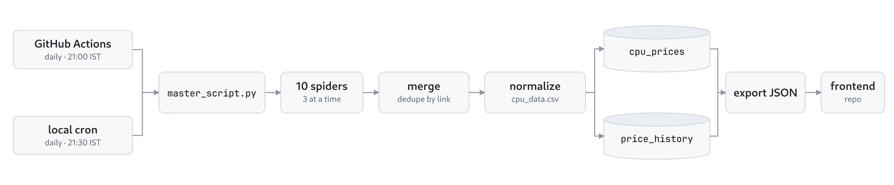

# CPU Price Tracker — Backend

A daily ETL pipeline that tracks desktop CPU prices across **ten Indian
retailers**, normalizes every listing against a curated specs dictionary, and
stores a current snapshot plus an append-only price history in MySQL. A separate
frontend repository consumes exported JSON and renders the charts.

**Live:** [cpu-price-tracker.vercel.app](https://cpu-price-tracker.vercel.app/)

No Indian retailer publishes cross-vendor CPU price history, so this pipeline
builds it: one row per listing per day, queryable by model, vendor, and date.

## Pipeline



1. **Scrape** — one `scrapy crawl` subprocess per vendor, up to three in
   parallel. Process isolation means a hung browser or a crashing spider cannot
   take down the other nine, and each vendor keeps its own log.
2. **Merge** — concatenate the ten JSON feeds and drop duplicate links.
3. **Normalize** — regex-clean each listing name, match it against
   `cpu_data.csv`, and attach specs (brand, generation, cores, threads, TDP).
   Unmatched listings are written to `processors_unmatched.json` and counted,
   not dropped.
4. **Store** — upsert `cpu_prices`, append to `price_history`.
5. **Export** — write `processors.json` and `price-history.json` into the
   frontend repo, then commit and push.
6. **Verify** — compare per-vendor counts against the previous run; exit
   non-zero if any vendor is short or missing.

## Data model

```sql
-- current state: one row per listing, overwritten each run
CREATE TABLE cpu_prices (
    id INT AUTO_INCREMENT PRIMARY KEY,
    name VARCHAR(255), link VARCHAR(500), price INT, vendor VARCHAR(255),
    brand VARCHAR(50), generation VARCHAR(50), series VARCHAR(50),
    cores INT, threads INT, base_clock_ghz FLOAT, tdp_watt INT,
    UNIQUE KEY unique_vendor_link (vendor, link)
);

-- history: one row per listing per day, never updated
CREATE TABLE price_history (
    id INT AUTO_INCREMENT PRIMARY KEY,
    name VARCHAR(255), vendor VARCHAR(255), link VARCHAR(500), price INT,
    snapshot_date DATE NOT NULL,
    is_synthetic TINYINT(1) NOT NULL DEFAULT 0,
    UNIQUE KEY uniq_vendor_link_date (vendor, link, snapshot_date)
);
```

`cpu_prices` answers "what does this cost right now" and is written with
`ON DUPLICATE KEY UPDATE`. `price_history` answers "how has it moved" and is
written with `INSERT IGNORE`, so a second run on the same day is a no-op rather
than a duplicate.

Three consequences worth stating:

- **`link` is identity, not `name`.** Retailers rename products
  ("AMD Ryzen 7 5800X3D Processor" vs "AMD Ryzen 7 5800X3D"); URLs are stable.
- **Idempotent writes are what allow two schedulers.** The CI run and the local
  run cover overlapping vendors thirty minutes apart and never need to
  coordinate.
- **`is_synthetic` marks reconstructed rows** from the historical backfill. Real
  observations always take precedence, and `DELETE FROM price_history WHERE
  is_synthetic = 1` removes the layer in one statement.

## Coverage

Counts below are the vendor's own, read from the page or API on the last full
run — not values typed in by hand.

| Vendor | Retrieval | Products | Count source |
|---|---|---|---|
| MDComputers | HTML | 63 | banner: 63 of 63 |
| The IT Depot | HTML, 3 s delay | 53 | banner: 53 across 5 pages |
| Vedant Computers | HTML, `limit=100` | 41 | banner: 41 of 41 |
| Ezpz Solutions | HTML | 43 | none; stops when the next link is absent |
| Elitehubs | Search API (JSON) | 50 in stock | `total` in the response |
| Vishal Peripherals | Shopify search + browser | 42 of 46 | search page: 46 of 141 |
| Shweta Computers | Shopify `products.json` | 81 | none; endpoint has no total |
| Computech Store | HTML | 101 | 6 pages of 20; stops on repeated links |
| SCL Gaming | Browser + class names | 70 in stock of 213 | `instock` cards |
| PC Studio | WooCommerce Store API | 67 | `count` in the category response |

All ten run from a residential IP. Eight also run in CI; SCL Gaming and PC
Studio refuse every route from GitHub's hosted IP ranges, so they are covered by
the local nightly run. Vishal's four-product gap is products with no priced
variant in the rendered grid.

## Health checks

`cpu_price_tracker/validation.py` runs after the insert:

- **Absolute floor** — fewer than 3 rows from a vendor is always wrong.
- **Drop against the previous run** — under 60% of the last non-synthetic count
  is treated as data loss, not a quiet day.
- **Disappearance** — a vendor in `EXPECTED_VENDORS` that produced nothing is
  reported by name.

Failures exit non-zero so the CI run goes red and emails. The check runs after
the insert and after the frontend push, so a red run still stores and publishes
the partial data. `EXPECTED_VENDORS` lists the eight vendors the runner can
reach; including the two blocked ones would make the job red every night for a
cause no code change can fix.

## Setup

```bash
python3 -m venv .venv
.venv/bin/pip install -r requirements.txt
.venv/bin/playwright install chromium
```

`.env` (gitignored):

| Variable | Purpose |
|---|---|
| `DB_HOST`, `DB_PORT`, `DB_USER`, `DB_PASSWORD`, `DB_NAME` | MySQL connection |
| `DB_SSL_CA` | path to the CA certificate (`certs/ca.pem`) |
| `FRONTEND_PAT` | token used to push exported JSON to the frontend repo |

```bash
.venv/bin/python master_script.py          # full pipeline
python -m unittest discover -s tests -t .  # 21 tests, no network or database
```

## Configuration

`cpu_price_tracker/settings.py` holds the defaults; spiders override them in
`custom_settings` where a site needs different treatment.

| Setting | Value |
|---|---|
| `DOWNLOAD_DELAY` | 3 s |
| `CONCURRENT_REQUESTS_PER_DOMAIN` | 1 |
| `RETRY_TIMES` / `RETRY_HTTP_CODES` | 3 / 408, 429, 5xx |
| `AUTOTHROTTLE_*` | enabled, 5–60 s, target concurrency 1.0 |
| `ROBOTSTXT_OBEY` | `False` |
| Playwright | `chromium`, headless, 30 s navigation timeout |

Two spiders use `scrapy-playwright`: Vishal's grid is painted client-side, and
SCL's listing has no server-rendered products. The rest read the server's HTML or
a JSON endpoint, which is faster and does not depend on a browser.

## Repo layout

```
master_script.py             orchestrator: spiders → merge → normalize → MySQL → export
export_website_json.py       MySQL → frontend JSON
backfill/                    one-time synthetic history + market anchors
cpu_price_tracker/
  spiders/                   one spider per vendor (10)
  normalize_cpu_names.py     name cleaning + dictionary matching
  validation.py              post-run vendor checks
  listing.py                 parses a vendor's own "X of N" total
  settings.py                Scrapy and Playwright configuration
  data/cpu_data.csv          specs dictionary (184 CPUs)
tests/                       normalizer, listing parser, health checks
```

## Tests

21 tests, all offline:

- `test_normalize.py` — name cleaning, dictionary matching, null names
- `test_listing.py` — the `Showing X of N` parser
- `test_validation.py` — floor, proportional drop, missing vendor

They run before the crawl in CI, so a broken parser fails the job before it can
write bad rows.

## Known limitations

- **Two vendors need a residential IP.** SCL Gaming and PC Studio reject GitHub's
  hosted ranges on every route, API included. The local cron is the workaround;
  a residential proxy is the paid alternative.
- **Shweta's throughput depends on the egress IP.** Shopify enforces a per-IP
  request budget, and the CI job therefore runs on `windows-latest`.
- **Coverage is not always provable.** Shopify's `products.json` exposes no
  total, so for Shweta completeness is inferred from the response, not compared
  against a stated count.

## Roadmap

- [x] Append-only price history + daily snapshots
- [x] Historical backfill fitted to market anchors
- [x] Scheduled runs (GitHub Actions, daily 9 pm IST)
- [ ] Analytics layer (SQL + pandas) and dashboards (Streamlit, Tableau Public)
